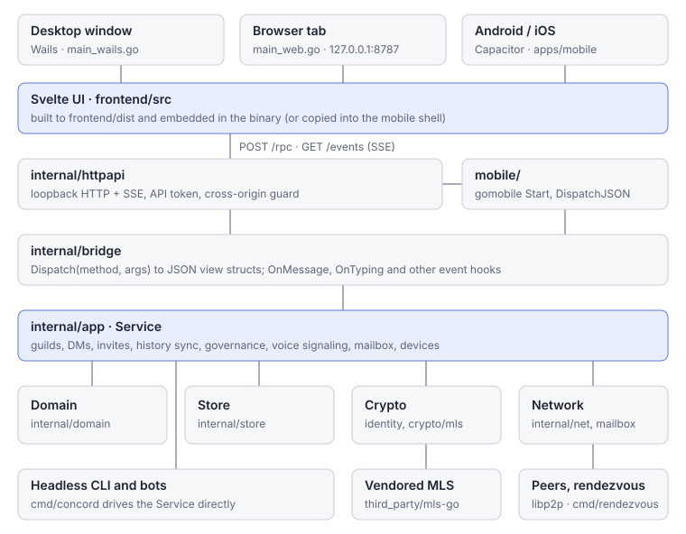

# Architecture

How Concord's code is layered, from the Svelte UI down through the Go core to the network, and how the same core is packaged as a desktop window, a browser-served binary, a phone app and a headless client.

There is one Go core and one Svelte UI. Every front end runs both in a single process on the user's device and connects them over the same loopback HTTP surface. The only separately deployed program is the rendezvous node, and peers do not need it to talk to each other once they can connect. [§14 of DESIGN.md](../DESIGN.md#14-map-of-the-code) has the package map; this page explains how the pieces fit.

## The Go core

The core lives under `internal/`. Each layer depends only on the ones below it.

| Package | Role |
|---|---|
| `internal/identity` | Ed25519 account and device keys, device certificates, the Argon2id keystore, BIP39 recovery words |
| `internal/crypto/mls` | The group-encryption engine: a small `Engine` interface over the vendored MLS library in `third_party/mls-go` |
| `internal/domain` | The pure data model (guilds, channels, messages) and topic-name derivation. No I/O |
| `internal/store` | The local SQLite database, with message bodies sealed at rest |
| `internal/net` | The libp2p host: mDNS and DHT discovery, circuit relay, gossipsub, and the `/concord/*` stream protocols |
| `internal/mailbox` | The offline store-and-forward mailbox protocol, and its push bridge on the rendezvous side |
| `internal/link` | Device-linking offers and the HMAC proof both devices exchange |
| `internal/compactcode` | The compact binary layout of invite and link codes |
| `internal/chronimport` | Reads channel-export JSON archives into a guild's chronicle |
| `internal/app` | The `Service`: owns every other layer and implements every feature |
| `internal/bridge` | The UI-facing API over the `Service`, plus signed self-update and peer-to-peer update |
| `internal/httpapi` | The HTTP and SSE transport every front end uses |
| `internal/version` | The release tag, stamped in at link time |

### Network

`internal/net` wraps a single libp2p host per process. Peers find each other three ways: mDNS on the local network (service tag `concord._mdns._v1`), a Kademlia DHT under the key `concord/dht/v1`, and addresses carried inside invite codes. A peer behind a NAT is reached through a circuit relay until hole punching gives a direct connection; a peer that learns it is publicly reachable also relays for members of its own guilds. [§4](../DESIGN.md#4-discovery-what-a-distributed-hash-table-is-and-how-concord-finds-people) and [§5](../DESIGN.md#5-reachability-nat-hole-punching-and-relays) of DESIGN.md cover why.

Live traffic travels on gossipsub topics; everything that is point-to-point travels on a dedicated stream protocol. [Protocol and data model](protocol.md) lists both.

### MLS engine

Each guild, DM, group DM and meeting is one MLS group (RFC 9420). `internal/crypto/mls` hides the library behind an `Engine` interface (`CreateGroup`, `Invite`, `AddMembers`, `Join`, `ApplyCommit`, `Encrypt`, `Decrypt`, and so on), so the rest of the core never touches MLS types. The library is vendored under `third_party/mls-go` and wired in with a `replace` in `go.mod`; its local changes are recorded in `THIRD-PARTY-NOTICES.md`.

### Store

`internal/store` is SQLite through `modernc.org/sqlite`, a pure-Go driver, so no build needs a C toolchain for it. Message bodies are sealed with NaCl secretbox under a key derived from the unlocked identity; structural metadata is stored in the clear so it can be queried and ordered. The database is `concord.db` in the data directory, next to `keystore.json`. `CONCORD_HOME` overrides the data directory, which is how `make peers` runs several isolated peers on one machine.

### The Service

`internal/app` is where features live. `Service` starts the libp2p host, subscribes to each guild's topics, runs the background loops (history reconcile, stranded-guild healing, mailbox drains), and exposes plain Go methods for everything the UI can do. Its files are named after features: `guild.go`, `dm.go`, `sync.go`, `governance.go`, `voice.go`, `mailbox.go`, `invite.go`, `link.go`, `forum.go`, and so on.

## The bridge and the transport

The UI never calls the `Service` directly.

- `internal/bridge` wraps the `Service` and translates domain types into JSON-friendly view structs. Its `Dispatch(method, args)` switch in `bridge.go` is the complete list of methods the UI can call. Events flow the other way through hooks on the `Bridge` (`OnMessage`, `OnPresence`, `OnTyping`, `OnVoiceSignal`, `OnGuildUpdate`, `OnReadState` and others).
- `internal/httpapi` serves that bridge over HTTP: `POST /rpc` takes `{"method", "args"}` and returns the result, and `GET /events` is a server-sent-event stream fed by the bridge hooks. It enforces an API token when one is configured (an `Authorization: Bearer` header on `/rpc`, a `?token=` query parameter on `/events`, because `EventSource` cannot set headers) and, except for the desktop webview, rejects requests carrying a foreign `Origin` so a website cannot drive the loopback API.
- `frontend/src/lib/api.js` is the client side of that transport. Every front end uses it unchanged; only the base URL and token differ.

To add an API method, add it to the `Service`, wrap it on the `Bridge`, add a `case` to `Dispatch`, and call it from `api.js`.

## Front ends

The same UI and core are packaged four ways.

| Front end | Entry point | How the UI reaches the core |
|---|---|---|
| Browser-served build | `main_web.go` (`//go:build !wails`, the default) | A loopback HTTP server on `127.0.0.1:8787` (`CONCORD_WEB_ADDR` overrides it), token on the URL, opens the default browser |
| Desktop window | `main_wails.go` (`//go:build wails`) | The same `httpapi` server mounted as middleware on the Wails asset server; no token, since no other site can reach the webview |
| Android and iOS | `mobile/mobile.go` plus `apps/mobile` | The core runs in-process and serves `httpapi` on a loopback port with a bearer token |
| Headless | `cmd/concord` | No UI: `--status`, `--serve`, and `--bot` (JSON lines on stdin and stdout, see [Bots](../BOTS.md)) drive the `Service` directly |

### Browser-served build

A plain `go build .` produces this variant. It embeds `frontend/dist` with `//go:embed all:frontend/dist`, so the binary is self-contained, and it has no system dependencies, which is why it is the one cross-compiled for every OS in a release.

### Wails desktop window

Built with the `wails desktop production webkit2_41` tags. It links the system WebView through cgo (`webkit2gtk-4.1` on Linux). It deliberately does not use Wails' generated JavaScript bindings: the desktop window talks to the same `/rpc` and `/events` endpoints as the browser build, which is why the frontend has one transport and not two. The comment at the top of `main_wails.go` explains the constraint. Files with `wails && linux` or `wails && windows` build tags hold the platform-specific pieces (renderer settings, WebKit media permissions, and the self-install that copies a downloaded binary into the user's application directory).

### Mobile: Capacitor shell and gomobile core

`mobile/mobile.go` is the gomobile binding surface. `gomobile bind ./mobile` compiles the whole Go core into an Android `.aar` or an iOS `.xcframework`. The binding is small on purpose, because gomobile only passes strings, numbers, bools and byte slices:

- `Start(dataDir)` boots the core and serves the loopback `httpapi` with a bearer token, answering CORS for the Capacitor webview origins.
- `DispatchJSON` lets native code call the bridge while the webview is gone, for notifications and background mailbox drains.
- An `EventSink` receives bridge events natively, in parallel with the SSE stream.

`apps/mobile` is the Capacitor project. Its `webDir` is `../../frontend/dist`, so `npx cap sync` copies the same built UI into each platform. The native side is Java on Android (`apps/mobile/android/app/src/main/java/app/concord/mobile/`: `ConcordCorePlugin`, the foreground and call services, the notifier) and Swift on iOS (`apps/mobile/ios/App/App/ConcordCorePlugin.swift`). In the UI, `api.js` detects `window.Capacitor` and points itself at the core's port and token.

## The Svelte frontend

`frontend/src` is a Svelte 5 app built with Vite. `main.js` mounts `App.svelte`; top-level components sit beside it, dialogs are under `modals/`, and logic that is not markup is in `lib/` (state, markdown rendering, emoji, keybindings, the API client). Files ending `.svelte.js` use Svelte runes for shared reactive state. Pure logic in `lib/` has `*.test.mjs` tests run by plain Node (see [Testing](testing.md)).

Fonts, emoji and sounds are bundled with the UI rather than fetched at runtime; [§12 of DESIGN.md](../DESIGN.md#12-assets-why-nothing-is-fetched-at-runtime) explains why.

## The rendezvous

`cmd/rendezvous` is the optional, untrusted infrastructure node. One libp2p host serves the DHT, a circuit relay, the offline mailbox (with optional push wakes), a guest gateway for browser guests joining a meeting, a GIF search proxy, a public booking page, and an optional TURN relay. It sees only ciphertext and connection metadata. A stable identity comes from `CONCORD_RELAY_SEED`; `make rendezvous-run` starts one locally. [Running a rendezvous](../RENDEZVOUS.md) covers operating one, and [§6 of DESIGN.md](../DESIGN.md#6-the-rendezvous-node) covers what it can observe.
