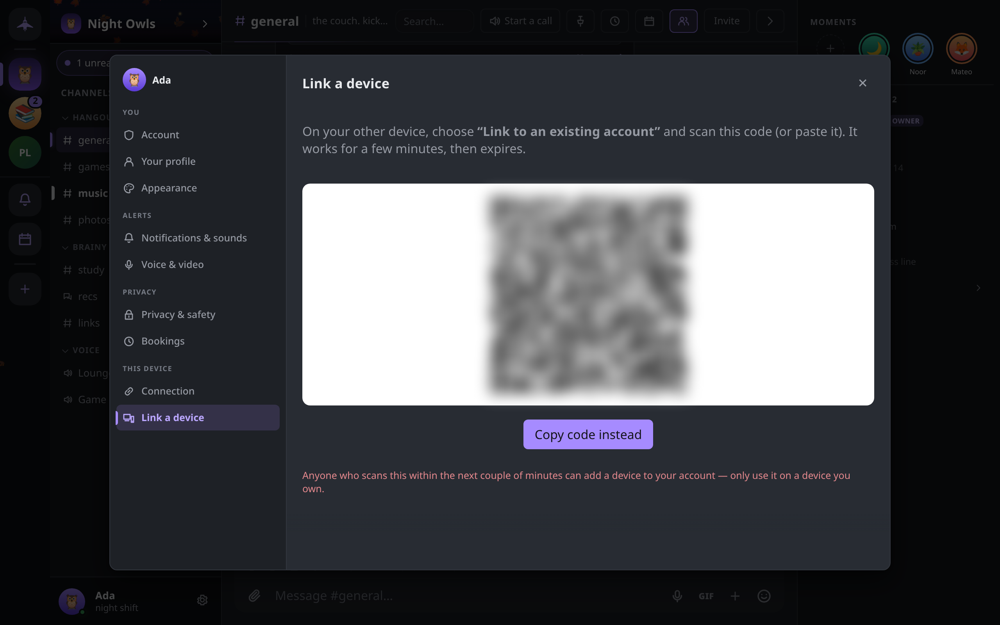

# Multiple devices and sync

How to use one account on several devices: linking a new device with a QR code, what it receives and what stays separate afterwards, and how to remove a device you no longer use or no longer have.

## How linking works

A linked device is not a copy of another one. Each device has its own device key, generated on it and never sent anywhere. When you link, your existing device signs a certificate saying the new device key belongs to your account, and hands over the account key. The new device then joins each of your guilds as its own member, under your account. Other people see one person with one fingerprint, whichever device you use.

Linking needs both devices online at the same time and able to reach each other. On the same network that is immediate; across the internet it goes through a rendezvous and can take up to a minute.

## Link a new device

1. On the device that already has your account, open **Settings → Link a device**. It shows a QR code and a **Copy code instead** button.
2. On the new device, at the first-run screen, choose **Link to an existing account**.
3. Select **Scan QR code** and point the camera at the code, or paste the copied code into the box. **Scan QR code** appears on touch-screen devices with a camera, such as a phone; on a computer, paste the code.
4. Choose a passphrase for the new device and type it twice. It protects your identity on that device only and does not have to match the passphrase on your other devices.
5. Select **Link this device**, and keep both devices on their linking screens until it finishes.

The code is single-use and expires two minutes after it is shown. Anyone who scans it within that time can add a device to your account, so only scan it with a device you own.

An already-set-up device can be re-linked from its unlock screen with **Re-link from another device**. This replaces the account material on it with your account's and sets a new passphrase, which is also the way to recover a device whose passphrase you have forgotten.

## What the new device receives

At the moment of linking, your existing device sends:

- the account key and the certificate for the new device;
- your profile;
- your rendezvous address;
- the list of people you have verified;
- an invitation to every guild and direct-message conversation on the existing device, except direct messages you have hidden.

The new device joins each of those through the guild's normal admission path, then catches up on history from the members who are online, your other devices included. If a guild cannot be handed over, for example because nobody who can admit new members is reachable, the new device is told which guilds are missing rather than leaving them out silently. Ask for a fresh invite to those.

## What stays in sync

Once linked, every device is a full member of your guilds and conversations, so new messages reach each of them directly. In addition, your devices keep each other up to date on:

| What | How |
|---|---|
| Messages and guild changes | Each device receives them as a member, and catches up from other members (including your other devices) after being offline |
| Your profile | An edit on one device is adopted by the others |
| What you have read | Read positions are shared between your own devices only, so reading a channel on one clears it on the others |
| Your Notes | A private conversation whose only members are your own devices |
| Bookings | Bookings people make on your booking page land in your Notes, on every device |

Your devices also look for each other actively, so a device that comes back online reconnects to your others without waiting on discovery.

## What stays on each device

Some things are deliberately local:

- **Settings and appearance**: theme, colors, notification choices, microphone and camera, push-to-talk key. In the single-file build these belong to the browser profile you open it in.
- **Saved messages** (bookmarks) never leave the device they were saved on. A [backup](backups.md) carries them.
- **Message history settings**: a guild's retention rule is applied by each device to its own copy.
- **The passphrase**, and on Android the biometric unlock.

## See your devices

**Settings → Connection → Stats & diagnostics** opens the diagnostics panel; `Ctrl+Shift+,` opens it directly. Its **Your devices** section lists every device signed in to the account: its name, the version it runs, whether it is online or when it was last seen, and how it is connected. The device you are using is marked **this one**.

## Remove a device

In **Your devices**, select **Unlink** next to the device and confirm.

Unlinking takes effect in two parts:

- **Immediately**, the device is removed from all your guilds and stops receiving anything new. Whoever holds it cannot undo that.
- **The next time it comes online** with Concord running, the device erases its own copy of your identity, guilds and messages, and shows a notice that it was unlinked. A device that stays off keeps what it had already downloaded, and nothing can reach it to delete it. If a device was lost or stolen, treat everything on it as already read.

You cannot unlink the device you are using. To erase the current device, use **Settings → Privacy & safety → Delete everything on this device**, which asks you to type a confirmation phrase first. That removes the identity, guilds and history from this device only. If another of your devices is still linked, linking this one again brings everything back.
