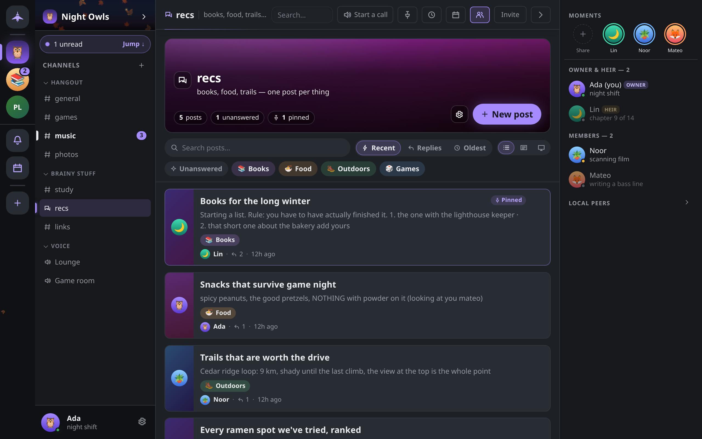

# Forum boards

A forum channel is a board of posts, each with its own title and thread of replies. This page covers writing posts, tags, answered and closed posts, and sorting, filtering and laying out a board.

## Creating a forum

A member with **Manage channels** creates one like any channel: **+** beside **Channels** → **New channel** → **Forum**. The **Study group** guild template includes a `#questions` forum. See [Guilds and channels](guilds.md#channels-and-categories).

## Posts

Open the forum channel to see its board. Click **New post** (on a phone, the round **+** button).

- **Title**: required, up to 200 bytes. A counter shows what is left.
- **Tags**: tap any of the forum's tags to put them on the post, up to 5.
- **Body**: the opening message. Markdown and the formatting toolbar both work, and you can paste or drop an image to attach it.

If you close the dialog with unsaved work, choose **Keep writing**, **Discard** or **Save for later**. A saved draft is kept on this device and comes back the next time you open **New post** in that forum; **Start over** clears it.

Click a post to read and reply. A post is an ordinary thread: replies, reactions, edits and attachments work as in any channel. The header above it leads back to the board. Posts do not appear as rows in the channel list; their unread counts add to the forum's row.

Members with **Manage messages** cannot pre-pin a post as they write it: a new post always arrives unpinned, and pinning is a separate step.

## Managing a post

Open a card's **Post actions** menu (**⋯**), or right-click it.

| Action | Who can do it |
|---|---|
| **Open post** | Everyone |
| **Mark answered** / **Mark unanswered** | The post's author, and members with **Manage messages** |
| **Edit tags…** | The post's author, and members with **Manage messages** |
| **Pin to board** / **Unpin from board** | Members with **Manage messages** |
| **Close post** / **Reopen post** | Members with **Manage messages** |
| **Delete post** | The post's author, and members with **Manage messages** |

The author is whoever wrote the post's opening message, as recorded by the encrypted group, not a name anyone typed.

**Marking a post answered** leaves the conversation open. **Closing a post** stops new messages: every member's app refuses to send into it and drops anything that arrives for it, moderators included. Reopening it is a separate, recorded step. A modified client can still send to a closed post, but no honest member will see it.

## Tags

Each forum has its own tag palette, edited in **Board settings** (the gear on the board's header) under **Tags** by members with **Manage channels**. Everyone else sees the palette read-only.

- Up to 20 tags per forum, and up to 5 per post.
- Each tag has a name (up to 24 characters), a color and an optional emoji.
- Click **Save tags** to publish the palette to everyone in the guild.

Deleting a tag removes it from the palette; posts that carried it simply stop showing it. If a forum has no tags yet, a member with **Manage channels** sees **Create tags for this forum…** in a post's menu.

## Finding posts

The bar above the board holds:

- **Search posts…**: matches posts whose title, preview text or author name contain every word you type, ignoring case and accents. This searches the board only; for message search across everything, see [Search](search.md).
- **Sort**: **Recent activity** (the default), **Most replies** or **Oldest first**. Pinned posts stay at the top in every order.
- **Layout**: **List**, **Gallery** or **Cover** (see below).
- **Filter chips**: **Unanswered** shows posts not marked answered that have no replies yet. Tag chips show posts carrying any of the selected tags. **Clear** resets the filters.

On a phone, sort and layout are together under **View**. The board's header also counts closed and pinned posts.

## Layout and banner

**Board settings → Board look** offers three card layouts:

| Layout | Shape |
|---|---|
| **List** | Dense rows, thumbnail on the left |
| **Gallery** | Media on top, text underneath |
| **Cover** | Full-bleed art behind the title |

The layout is a reading preference stored **on this device** only; other members choose their own. Members with **Manage channels** can also set the forum's banner art (**Auto**, one of the preset banners, or **Upload…** an image of up to 384 KiB), which everyone in the guild sees.

