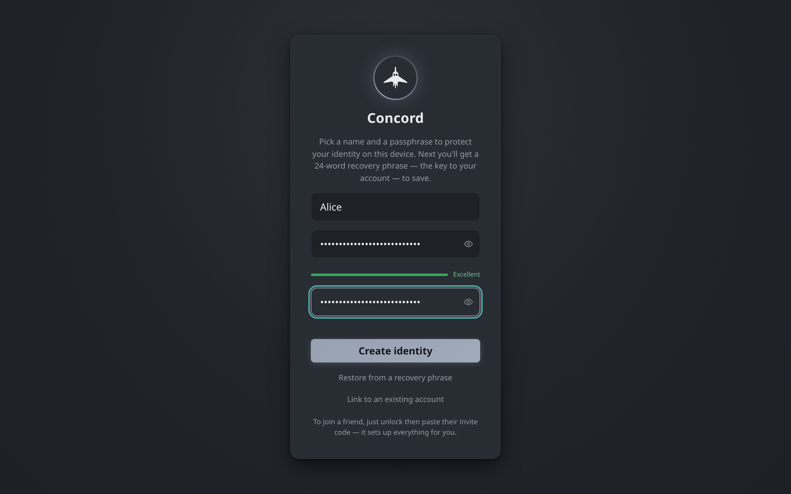

# Getting started

How to install Concord on each platform, create your identity on first run, start or join a guild, and check that other people can reach you.

## Pick a download

Every release on the [releases page](https://github.com/ZahakJ/concord/releases/latest) carries these files, with the version in each name:

| Platform | File | What it is |
|---|---|---|
| Linux (x86-64) | `concord-linux-amd64-<version>` | Single-file build that opens in your browser |
| Linux (ARM64) | `concord-linux-arm64-<version>` | Same, for ARM64 machines |
| Linux (x86-64) | `concord-desktop-linux-<version>` | Native desktop app in its own window |
| macOS (Apple silicon) | `concord-macos-arm64-<version>` | Single-file build that opens in your browser |
| macOS (Intel) | `concord-macos-intel-<version>` | Same, for Intel Macs |
| Windows | `Concord-Setup-<version>.exe` | One-click installer for the desktop app |
| Windows | `concord-desktop-windows-<version>.exe` | The desktop app as a standalone file |
| Windows | `concord-windows-<version>.exe` | Single-file build that opens in your browser |
| Android 8.0 and later | `concord-<version>-android.apk` | The Android app (64-bit ARM phones) |

`SHA256SUMS` lists the hash of every file, and `SHA256SUMS.sig` is an Ed25519 signature over that list. The in-app updater checks the signature before it trusts any hash.

The single-file builds and the desktop apps run the same app. The difference is only the window: the single-file build serves the interface to your own browser on `127.0.0.1`, and the desktop app draws it in a native window.

## Linux

### Single-file build

The install script downloads the build for your CPU, checks it against `SHA256SUMS`, and puts it at `~/.local/bin/concord`. Nothing runs as root.

```sh
curl -fsSL https://zahakj.github.io/concord/install.sh | sh
concord
```

Running `concord` opens your browser on the app. Set `PREFIX` to install somewhere other than `~/.local/bin`; the script warns if that directory is not on your `PATH`. Running the script again updates in place, and so does the app itself (see [Updates](#updates)).

To install by hand, download `concord-linux-amd64-<version>` or `concord-linux-arm64-<version>`, make it executable with `chmod +x`, and run it.

### Desktop app

Download `concord-desktop-linux-<version>`, make it executable, and run it. It needs WebKitGTK 4.1 (the `webkit2gtk-4.1` package on most distributions).

The first time you run it from anywhere else, it installs itself for your user: the program goes to `~/.local/share/concord`, and a launcher entry and icon are added so Concord shows up in your application menu. It then restarts from that location. A copy under `/usr`, `/opt`, `/nix`, `/snap` or `/app` is left where it is, since a package manager owns those paths.

To remove the installed copy, run it with `--uninstall`. Your identity and messages are kept; see [Where your data lives](#where-your-data-lives).

## macOS

macOS releases ship the single-file build, which opens in your browser. The install script works the same way as on Linux and picks the Apple silicon or Intel build for you:

```sh
curl -fsSL https://zahakj.github.io/concord/install.sh | sh
concord
```

You can also download `concord-macos-arm64-<version>` or `concord-macos-intel-<version>`, make it executable with `chmod +x`, and run it from Terminal.

## Windows

Run `Concord-Setup-<version>.exe`. It installs Concord for your user account with no administrator prompt and no wizard, adds it to the Start menu and the desktop, and launches it. The app goes to `%LOCALAPPDATA%\Concord`. Uninstall it from **Add or remove programs**; your identity and history are kept.

The standalone `concord-desktop-windows-<version>.exe` does the same thing on its first run: launched from your Downloads folder or anywhere else, it copies itself to `%LOCALAPPDATA%\Concord`, creates the shortcuts and the uninstall entry, and restarts from there.

`concord-windows-<version>.exe` is the single-file build. It installs nothing and opens Concord in your browser.

The Windows files are not code-signed, so SmartScreen or Defender may warn about them. [WINDOWS.md](../../WINDOWS.md) walks through each warning.

## Android

Download `concord-<version>-android.apk` on the phone and open it. Android asks you to allow installs from the app you downloaded it with (usually the browser) the first time. The APK is built for 64-bit ARM phones running Android 8.0 or later.

The Android app keeps a background connection open while **Stay connected** is on, which is the default, so messages arrive while the app is closed. See [Notifications](notifications.md).

A few things work differently on a phone. Discovery of other devices on the same Wi-Fi does not run on Android, so a phone needs an invite code or a rendezvous to reach anyone (see [Can people reach you?](#can-people-reach-you)). Keyboard shortcuts and push-to-talk are desktop-only. Unlocking with your fingerprint or face is available instead of typing the passphrase.

## The single-file build

The single-file build is a local web server with the app built in. When it starts, it listens on `127.0.0.1:8787`, prints the address, and opens your default browser on it. The address includes an access token, new on each launch, that the page stores and then removes from the address bar; other programs on the machine cannot use the app's interface without it.

Two environment variables change this:

| Variable | Effect |
|---|---|
| `CONCORD_WEB_ADDR` | Listen on another address and port instead of `127.0.0.1:8787` |
| `CONCORD_NO_OPEN` | Do not open a browser. The printed address (with its token) is the way in. |

Settings that belong to the interface, such as the theme, are stored by the browser. Opening the same build in a different browser starts those settings from their defaults.

People you invite to a meeting room can join from their own browser without installing anything; see [Voice, video and screen sharing](voice-and-video.md).

## iOS

There is no iOS download. The repository contains the iOS app project (`apps/mobile/ios`, targeting iOS 15.0) and `make ios-app` builds it on a Mac with Xcode, but no release includes an iOS build. In-app updating is turned off on iOS.

## First run: your identity

There is no sign-up. The first time Concord opens on a device, it asks for two things:

1. **Your name**: what other people see, up to 32 characters. You can change it later.
2. **A passphrase**, typed twice. It encrypts your identity and your messages on this device. A meter rates its strength, but nothing is enforced; a few unrelated words is a good passphrase.

Select **Create identity**. Concord generates your identity, a cryptographic key pair, and shows your **recovery phrase**: 24 words that can rebuild that key on any device. Select **Show phrase**, write the words down somewhere safe (on paper or in a password manager, not in a screenshot), then select **I've saved my recovery phrase**. Concord asks for two of the words to make sure you have them; **Show me the words again** goes back to the list.



The same screen also offers **Restore from a recovery phrase** and **Link to an existing account**, for when this is not your first device. See [Accounts and identity](identity.md) and [Multiple devices](devices.md).

### Unlocking

Each time Concord starts, it asks for your passphrase and you select **Unlock**. On a phone you can turn on biometric unlock after the first unlock. The passphrase is never stored or sent anywhere, so it cannot be reset. If you forget it, select **Forgot passphrase?**; [Backups and recovery](backups.md#if-you-forget-your-passphrase) explains the three ways forward.

## Your first guild

After unlocking with no guilds, Concord offers **Create a guild**, **Join with an invite code** and **Open your Notes** (a private space only your own devices can read).

### Create a guild

**Create a guild** asks for a name (up to 48 characters), an optional description and an icon, and a starting layout:

| Template | What it creates |
|---|---|
| Start empty | `#general` and nothing else |
| Community | `#welcome`, an `#announcements` channel, `#introductions`, `#off-topic` and a Lounge voice channel |
| Study group | `#resources`, a `#questions` forum and a Study Hall voice channel |
| Project | `#standup`, a `#decisions` announcement channel, `#code-review` and a Huddle voice channel |

Every guild starts with `#general`; a template adds its channels, grouped into categories, on top. Everything a template makes can be renamed or deleted afterwards. A new guild shows a **Get started** checklist: give it an icon, make your channels, write a welcome message, and invite people.

To invite someone, select **Invite** in the channel header. The invite shows a code and a QR code; **Copy code** copies it. The code carries the guild, how to reach you, and your rendezvous if you use one. Anyone holding the code can join, so send it directly to the people you mean. [Guilds and channels](guilds.md) covers invites, channels and roles in full.

### Join a guild

Select **Join with an invite code**, paste the code a friend sent you, and select **Join**. If the friend uses a rendezvous, joining with their code sets it as yours as well.

The command palette (`Ctrl+K`, `Cmd+K` on macOS) also has **Create guild** and **Join with an invite code**.

## Can people reach you?

Two devices must be able to connect to each other. Concord has no central server to fall back on, so whether that works depends on your networks:

| Where you are | What it takes |
|---|---|
| Same Wi-Fi, or the same VPN mesh | Nothing. |
| One side can forward a port | One router rule. The invite code carries that address. |
| Neither can | Someone in the group runs a [rendezvous](../RENDEZVOUS.md): one small always-on node that introduces peers and relays ciphertext. |

To see which row you are in, open the command palette (`Ctrl+K`) and choose **Can people reach me?**. The same check is at the bottom of the invite dialog. It gives a one-line verdict and, when something is missing, a button to fix it: **Set a rendezvous address**, **Pin a port**, or **Try reconnecting**. It then lists the three ways in:

- **Same network**: Concord finds other devices on the local network by itself. This does not run on Android, and many workplace and campus networks block it, so in practice it is desktop to desktop at home.
- **A port you forward**: pin one port in **Settings → Connection → Fixed port**, add a rule in your router sending it to this computer, and the invite codes you hand out let friends connect to you directly. Your home IP address is then in every invite code you give away. A port Concord picks itself changes every launch, which breaks the direct route in codes you have already shared; the check warns about this.
- **Somebody's rendezvous**: a node that introduces people who cannot connect directly and forwards their encrypted traffic. It does not have to be yours. Set or change it in **Settings → Connection → Rendezvous server**.

The check also shows whether the public DHT fallback is on. That helps people find you, not reach you, and it publishes your peer ID and addresses on a public network; it is off unless you turn it on. [Troubleshooting](troubleshooting.md) covers connections that still fail.

## Updates

The desktop apps, the single-file builds and the Android APK update themselves. When a release is out, Concord shows a banner; **Settings → Account** shows the update under **This install** with an **Update now** button. The update is downloaded, checked against the signed `SHA256SUMS`, and swapped in; **Restart now** finishes it. Concord can also pick up a newer version from a peer on your network. If the program's folder is not writable, the update card offers a download link instead.

## Where your data lives

| Platform | Location |
|---|---|
| Linux | `~/.config/concord` |
| macOS | `~/Library/Application Support/concord` |
| Windows | `%AppData%\concord` |
| Android | The app's private storage |

Setting `CONCORD_HOME` points the desktop and single-file builds at another directory. Uninstalling the app never removes this data. To erase it from inside the app, use **Settings → Privacy & safety → Delete everything on this device**.
