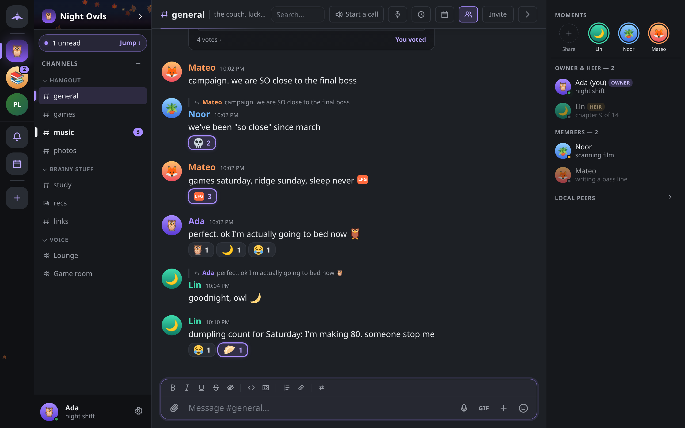
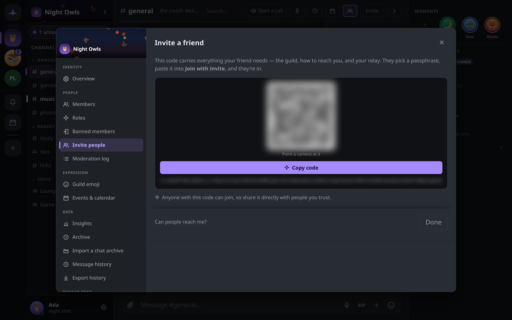

# Guilds and channels

How to create a guild, invite people and join one, organize channels and categories, and use messages, threads, polls and events. It also covers leaving a guild, handing it over, and importing an older community's history.

A guild is a shared, end-to-end-encrypted space with its own channels and members. It is not hosted anywhere: every member's device holds a copy, and the guild keeps running as long as members keep using it.



## Creating a guild

1. Click **+** (**Add a guild**) at the bottom of the guild rail on the left, then **Create a guild**. On a fresh install the welcome screen offers the same choice.
2. Type a name (up to 48 characters). Click the round bubble above it to choose an icon, and add an optional **Description**.
3. Under **Start with**, pick a starter layout. Each tile draws the sidebar it will build.

| Layout | What it makes |
|---|---|
| Start empty | One text channel, `#general` |
| Community | `#general`, plus categories with `#welcome`, `#announcements` (an announcement channel), `#introductions`, `#off-topic` and a **Lounge** voice channel |
| Study group | `#general`, `#resources`, a `#questions` forum and a **Study Hall** voice channel |
| Project | `#general`, `#standup`, `#decisions` (announcement), `#code-review` and a **Huddle** voice channel |

4. Click **Create**. Everything a template makes can be renamed or deleted afterwards.

You are the guild's **owner**. The owner holds every permission and outranks every role; see [Roles and permissions](roles.md).

## Inviting people

Anyone with the **Manage members** permission (and the owner) can invite. Open **Guild settings → Invite people**, or right-click the guild in the rail and choose **Invite / add people**. The **Invite a friend** panel shows:

- **The invite code**, as text and as a QR code. **Copy code** copies it; on a phone, **Share code…** opens the system share sheet.
- **Or add a verified contact directly**: contacts you have verified, with an **Add** button each. No code is needed. They receive an offer they can accept or **Ignore**, and they appear in the guild only once they accept.
- **Can people reach me?** opens a check of whether people on other networks can connect to you. See [Troubleshooting](troubleshooting.md).



### What an invite code carries

A code starts with `CI1` and holds:

- the guild's ID and name,
- the inviting device's peer ID and its current network addresses (including relay addresses it holds),
- the rendezvous nodes the inviter uses, so a new user's app is configured by the code alone.

It carries no keys and no messages. Redeeming it asks the inviting device to admit you into the encrypted group, so that device has to be online when you join.

Things to know:

- **Anyone with the code can join.** Share it directly with people you trust.
- **Codes do not expire**, but they name the inviter's addresses at the time, so an old code can stop working when that device's address changes. Ask for a fresh one.
- **Banned and kicked people are refused** at the door, whatever code they hold.

## Joining a guild

1. Click **+** in the guild rail, then **Join with an invite code** (or **Join a guild** on the welcome screen).
2. Paste the code. The dialog shows the guild's name once the code reads as complete.
3. Click **Join**.

The person who made the code must be online and reachable while you join. If they are not, the dialog says **That code didn't open the door. Ask your friend for a fresh one.** Once you are in, the guild's history syncs from whichever members are online.

## Guild settings

Click the guild's name at the top of the channel list, or choose **Guild settings** from the menu in the chat header. On a desktop the settings open as one window with every section listed on the left; on a phone they are a list you drill into. You see only the sections you can use.

| Group | Sections |
|---|---|
| Identity | **Overview**: name, icon, banner and description (editable with **Manage guild**) |
| People | **Members**, **Roles**, **Banned members**, **Invite people**, **Moderation log** |
| Expression | **Guild emoji**, **Events & calendar** |
| Data | **Insights**, **Archive**, **Import a chat archive** (owner only), **Message history**, **Export history** |
| Danger zone | **Ownership & heir**, **Leave guild** (**Leave and delete my copy** for the owner) |

Moderation (members, bans, mutes, the moderation log, message history limits) is covered in [Moderation and safety](moderation.md).

## Channels and categories

Members with **Manage channels** see a **+** beside the **Channels** heading, with **New channel** and **New category**. Without the permission the **+** is shown locked and explains why.

### Channel types

| Type | Label in the dialog | What it is |
|---|---|---|
| Text | **Text** | Messages, files and images |
| Voice | **Voice** | A call room; see [Voice, video and screen sharing](voice-and-video.md) |
| Announcement | **Announce** | A text channel only moderators can post in |
| Forum | **Forum** | A board of posts, each its own thread; see [Forum boards](forums.md) |

Text, announcement and forum channel names are turned into lowercase, hyphenated form (`Off Topic` becomes `off-topic`); voice rooms keep the name as typed. Duplicate names are allowed, but the dialog warns you.

In an **announcement** channel, only members with **Manage messages** or **Manage channels** can post. Everyone else's app refuses to send there, and every member's app drops a post from anyone else. A moderator can link the channel to other text channels in the same guild (right-click → **Linked channels**) and then use **Publish** on a message to post it into those channels with an optional comment.

### Managing channels

Right-click a channel (long-press on a phone) for:

- **Mark as read**, **Notifications** (per channel, or **Use guild default**), **Disappearing messages…**
- With **Manage channels**: **Change type to…**, **Move to…** a category, **Rename channel**, **Channel settings…**, **Delete channel**.

Channel names are up to 40 characters. **Channel settings…** holds the channel's **Topic** (up to 300 characters), **Slow mode** and **Message history**. Slow mode limits each member to one message per interval, up to 6 hours; members with **Manage messages** or **Manage channels** are exempt. On a desktop, channels can also be dragged between categories. Each category header has buttons to create a channel in it, rename it or delete it.

## Messages

### Sending

Type in the composer and press `Enter`; `Shift+Enter` adds a new line. Next to the text box:

- **Attach a file** (or paste or drop a file); see [Sharing files and media](files-and-media.md).
- **Record a voice message**, shown when the box is empty.
- **GIF**, the guild's GIF pack and a search.
- **+** (**Add to your message**): **Poll**, **Doodle**, **Sound**, **Game**, **Start a thread**, **Advanced composer**, **Seal the send time**, and **Schedule this message** (or **Scheduled messages** when the box is empty).
- The emoji picker.

On a phone these are in the **Add to your message** sheet.

### Formatting

Messages use Markdown.

| Type | Result |
|---|---|
| `**text**` | bold |
| `*text*` or `_text_` | italic |
| `__text__` | underline |
| `~~text~~` | strikethrough |
| `\|\|text\|\|` | spoiler, revealed on click |
| `` `code` `` | inline code |
| ` ```lang ` … ` ``` ` | code block with a language label |
| `# `, `## `, `### ` | headings |
| `> ` / `>>> ` | quote one line / quote the rest of the message |
| `- item`, `1. item` | lists |
| `[text](https://…)` | link with custom text; bare URLs link too |
| `{red\|text}` or `{#ff8800\|text}` | colored text; named colors are red, orange, yellow, green, teal, blue, purple, pink, gray |

Formatting shortcuts such as `Ctrl+B` (`Cmd+B` on macOS) are listed in [Keyboard shortcuts](shortcuts.md).

### Mentions

- `@name` mentions a member, and `@rolename` mentions everyone holding that role.
- `@everyone` and `@here` notify every member of the guild.
- `#channel` links to a channel and keeps working after it is renamed.

A mention counts toward the unread badge and notifications; see [Notifications and push](notifications.md).

### Slash commands

Type `/` at the start of a message for the list.

| Command | Effect |
|---|---|
| `/me <action>` | An action, in your name |
| `/spoiler <text>` | Hides text until clicked |
| `/shrug`, `/tableflip`, `/unflip`, `/fa` | Appends the matching text face |
| `/timestamp [message]` | Seals the exact send time onto the message |
| `/confetti`, `/fireworks`, `/hearts` | Sends with an animation |
| `/meme`, `/gif`, `/doodle`, `/sound`, `/game` | Opens the matching editor or picker |
| `/clear <n>` | Deletes the last *n* messages, up to 100 (needs **Manage messages**) |

### Acting on a message

Hover a message for its toolbar, or right-click it (long-press on a phone). The menu offers:

- **Reply**, **Add reaction**, **Copy text**, **Copy message link**, **Forward** (to any text channel or direct message), **Save message**, **Mark unread**, **Remind me**.
- **Edit**, on your own messages. `↑` in an empty composer edits your last message. Edited messages show **(edited)**.
- **Start thread**, in text channels.
- **Pin** / **Unpin**. In a guild this needs **Manage messages**; the pinned list is under **Pinned messages** in the chat header.
- **Publish**, in announcement channels.
- **Report message**, on other people's messages; see [Moderation and safety](moderation.md).
- **Delete**, on your own messages, and on anyone's with **Manage messages**.

A deleted message disappears from the conversation. In a guild its text is still kept on each member's device: turn on **Settings → Privacy & safety → Show deleted messages** to leave a faint marker in its place, and a member with **Manage messages** can right-click the marker and choose **Show original**. **Empty trash** in the same section erases the kept text on your device for good. Deleting in a direct message erases the text for real.

### Polls

**+ → Poll** opens the poll editor: a **Question** (up to 300 characters), 2 to 10 **Options** (up to 100 characters each), **Allow selecting multiple options**, **Closes** (**Never**, **1 hour**, **24 hours** or **3 days**), and **Quiz mode**, where one option is the correct answer. Votes travel as reactions, signed by the voter like any message, so polls are not anonymous.

### Threads

In a text channel, **Start thread** on a message (or **+ → Start a thread**) opens a side conversation with its own title (up to 200 bytes) and unread count. A thread started from a message quotes it and links back to it. Threads do not get their own row in the channel list; their unread counts add to the parent channel's row. Forum posts are threads too; see [Forum boards](forums.md).

### Disappearing messages

**Disappearing messages…** in a channel's or conversation's menu sets a timer of **5 minutes**, **1 hour**, **8 hours**, **1 day** or **1 week** (or **Off**). It is your choice for this conversation: messages *you* send afterwards carry the expiry and are erased on every device when it passes.

## Events

**Guild settings → Events & calendar** (or the calendar button in the chat header) holds the guild's shared calendar. Any member can create an event with a title, details, start time, duration, location (a place or one of the guild's channels) and a repeat rule: **Never**, **Every day**, **Every week**, **Every other week** or **Every month**. Members answer **Going**, **Maybe** or **No**, and the event's menu offers **Add to calendar (.ics)**. The author can edit or delete an event, and so can anyone with **Manage messages**.

## Leaving a guild

Choose **Leave guild** from the guild's right-click menu, the chat header menu, or **Guild settings → Danger zone**.

- Your copy of the guild's messages is deleted from this device. Everyone else keeps theirs, and the guild keeps running.
- The guild will not come back on its own, including through your linked devices. Rejoining takes a new invite.
- To keep the text, use **Guild settings → Export history** first. It writes every channel to one unencrypted Markdown file.

There is no way to delete a guild for everyone.

### If you are the owner

The button reads **Leave and delete my copy**. Ownership cannot be appointed after you leave, so before leaving, use **Guild settings → Ownership & heir**:

- **Transfer ownership…** hands the guild to another member immediately. It is one-way; only the new owner can hand it back.
- **Name an heir…** gives a member a standing, revocable right to **Take ownership** at any time. Use **Revoke** to withdraw it. Any change of owner clears the heir.

## Importing a chat archive

The owner can bring a community's older history into a guild from a chat export: a folder of JSON files, one or more per channel, optionally with an `assets` folder holding the media. Open **Guild settings → Import a chat archive**.

1. **Pick the folder.** The desktop app has a **Browse…** button. In the web build, type the path on the machine running Concord. Click **Read the folder**.
2. **Review the bill.** Concord reads the folder once, without writing anything or touching the network, and shows the message count, date span and media size, then a table of channels with what each **Lands in**. Untick channels to skip them. Matching is by name: a channel lands in this guild's existing channel of the same name and type, or in a new one.
3. **Set the policy.** Limit the **Dates** (**From**, **To**), choose **Attachments** (**Everything under the size limit**, **Images only** or **No attachments**) and **Skip anything larger than** **1 MB**, **5 MB** (default), **25 MB** or **No limit**. Toggle **Keep reactions** (shown as counts) and **Import custom emoji**, and set the **Label** members see beside the archive.
4. **Import.** The import runs as a background job; you can close the window and reopen it to see progress. There is no undo.

What to expect:

- **Nothing is fetched.** An attachment the export points at on a remote site, rather than including as a file, becomes a line naming the file and its size.
- **The history is an archive, not live messages.** It appears above the start of each channel's live history, signed by the owner. It does not raise anyone's unread count, and archived messages cannot be reacted to.
- **Members fetch pages as they scroll** to them, from other members, and keep what they read. **Guild settings → Archive** shows how much is on this device and offers **Keep the full archive on this device**. On a phone on a metered connection, pages are not fetched until you ask.
- Importing again replaces the archive the guild carries.
