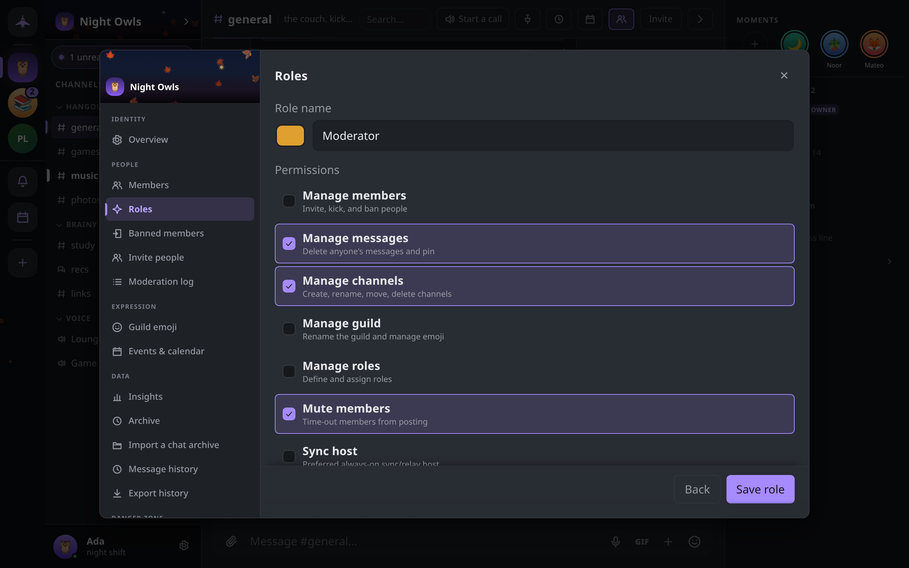

# Roles and permissions

How a guild decides who may do what: the owner, named roles, the seven permissions a role can grant, and the rank rules that stop anyone granting themselves more power than they have.

## How authority works

- **The owner** holds every permission and outranks every role. A guild has exactly one owner at a time; ownership moves only by transfer or by an heir claiming it (see [Leaving a guild](guilds.md#if-you-are-the-owner)).
- **Everyone else** gets their powers from **roles**. A role is a name, a color and a set of permissions. A member can hold several roles, and their permissions add up.
- **A member with no role** can read and post, react, start threads and forum posts, create events and use the guild's emoji and GIFs. Everything in the table below needs a role that grants it.

Every role change, ban, kick and mute is a signed record that every member's device checks for itself. An action signed by someone who was not allowed to take it is ignored by every honest client. The **Moderation log** in guild settings lists these records; see [Moderation and safety](moderation.md).

## The permissions

| Permission | Hint in the editor | What it lets a member do |
|---|---|---|
| **Manage members** | Invite, kick, and ban people | Get the guild's invite code and add verified contacts; admit new members; kick, ban and lift bans; set other members' nicknames (only for members of lower rank, never the owner) |
| **Manage messages** | Delete anyone's messages and pin | Delete anyone's message and use `/clear`; **Show original** on a deleted message; pin and unpin messages; post in announcement channels; skip slow mode; edit or delete anyone's event; pin, close and reopen forum posts, and edit any post's tags or answered state |
| **Manage channels** | Create, rename, move, delete channels | Create, rename, retype, move and delete channels and categories; edit channel topics, slow mode and an announcement channel's linked channels; set a forum's tags and banner; post in announcement channels; skip slow mode |
| **Manage guild** | Rename the guild and manage emoji | Edit the guild's name, icon, banner and description; add and remove custom emoji; curate the guild's GIF pack; set the guild-wide and per-channel message history limits |
| **Manage roles** | Define and assign roles | Create, edit and delete roles and assign them to members, within the rank rules below |
| **Mute members** | Time-out members from posting | Mute and unmute members |
| **Sync host** | Preferred always-on sync/relay host | Marks a member's device as a preferred source when others catch up on history or are re-added after missing changes; meant for an always-on machine |

Only the owner can import a chat archive, transfer ownership, or name an heir.

## Creating and editing roles

Open **Guild settings → Roles**, or right-click the guild in the rail and choose **Roles & permissions**. These are shown only to the owner and to members with **Manage roles**.

1. Click **New role**.
2. Enter a **Role name** (up to 32 characters) and pick its color.
3. Tick the **Permissions** it grants.
4. Click **Save role**.

Click a role in the list to edit it. The bin icon deletes it after a confirmation; the role is removed from everyone who held it, along with its permissions, and this cannot be undone.

A role's position in the hierarchy is its **rank**. The editor has no control for reordering: a new role is always placed above every existing one. Because nobody but the owner may create a role at or above their own rank, in practice only the owner can create roles here. A member with **Manage roles** can edit, delete and assign the roles that rank below them.

## Assigning roles

- **Guild settings → Members** lists everyone, sortable by **Name**, **Roles**, **Standing** and **Fingerprint**. The owner and members with **Manage roles** can add and remove roles there, for one member or a selection.
- A member's profile card and right-click menu offer **Make admin** (or **Remove admin**) to the owner and to anyone who holds every permission. It assigns a role named **Admin** that grants all seven permissions, creating it first if the guild has none.

Roles also work as mention groups: `@rolename` in a message notifies everyone who holds the role.

## Rank rules

A member's rank is the highest position among their roles. A member with no roles ranks below everyone; the owner ranks above everyone. For anyone but the owner:

- You can only create or edit a role **below your own rank**, and only with permissions **you already hold**.
- You can only delete or assign roles **below your own rank**.
- Nobody but the owner can give the owner a role.
- Nobody can ban, kick or mute the owner.
- A ban removes all of the member's roles.

Together these mean a member with **Manage roles** cannot raise themselves: any role they make is capped at their own permissions and must rank below them.

## What "enforced" means here

There is no server to refuse an action, so each rule is checked on every member's device. Removing a member from the encrypted group is a real cryptographic step: once kicked or banned they cannot read new messages. Mutes, slow mode, announcement-only posting and closed forum posts work differently: each member's app drops the messages that break them. A modified client can still send such a message, but no honest member's app will show it.
