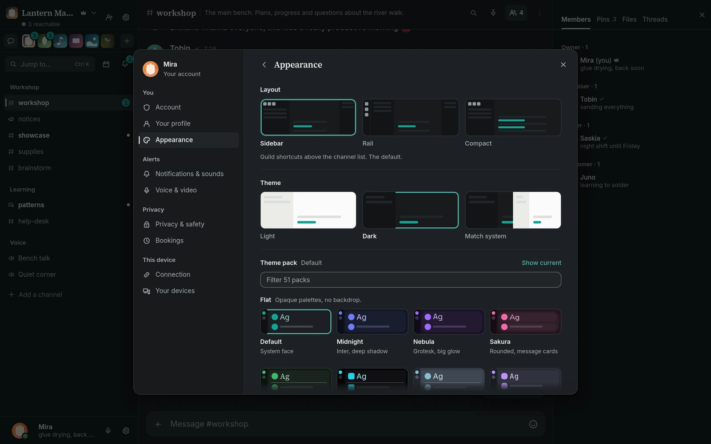

# Settings and themes

What is in Settings and where to find it, with a closer look at Appearance: theme, color, shape, type, reading, layout and effects.

## Opening Settings

On the desktop, press `Ctrl+,` (`Cmd+,` on macOS), choose **Open settings** in the command palette (`Ctrl+K`), or select the gear next to your name at the bottom of the channel list. Settings opens on **Account** with every other page in a rail down the side. On a phone, Settings is a list of the same pages grouped under headings; tap one to open it.

Settings in Concord are kept per device. Your theme, sounds and microphone on your laptop do not change the ones on your phone. In the single-file build they are stored by the browser, so a different browser starts from the defaults. Guild-wide settings are not here; they are under **Guild settings** in each guild's menu (see [Guilds and channels](guilds.md)).

## The pages

| Group | Page | What is there |
|---|---|---|
| Personal | **Account** | Who you are on this device, your safety net (**Backup & restore** and **Recovery phrase**), your passphrase, the installed version and updates, and **Sign out (lock this device)** |
| Personal | **Your profile** | Name, picture, banner, availability, status, bio, birthday, profile colors and your fingerprint |
| Personal | **Appearance** | Theme, accent color, corners, typeface, density, scale, links, name colors, clock, layout, motion and effects |
| Alerts | **Notifications & sounds** | Do Not Disturb, sound volume and effects, call ringtone, alert words, system notifications, and on a phone **Stay connected** |
| Alerts | **Voice & video** | Microphone, speaker and camera, voice activity or push-to-talk, noise reduction, noise gate, microphone boost, call volume and a record-and-play-back test |
| Privacy | **Privacy & safety** | What leaves this device, typing indicators, read receipts, what notifications show, deleted messages, message requests and blocked users, app lock, and erasing the device |
| Privacy | **Bookings** | Office hours and your public booking page |
| This device | **Connection** | Rendezvous server, fixed port, public DHT fallback, and the diagnostics panel |
| This device | **Your devices** | Every device on this account, unlinking, and the QR code for adding another |

The details live on the pages for each topic:

- Account, profile and passphrase: [Accounts and identity](identity.md)
- Backups and the recovery phrase: [Backups and recovery](backups.md)
- Notifications, Stay connected and push: [Notifications](notifications.md)
- Voice & video: [Voice, video and screen sharing](voice-and-video.md)
- Privacy & safety: [Privacy and encryption](privacy.md) and [Moderation and safety](moderation.md)
- Connection: [Getting started](getting-started.md#can-people-reach-you) and [Troubleshooting](troubleshooting.md)
- Link a device: [Multiple devices](devices.md)

### Privacy & safety at a glance

The **What leaves this device** group lists every feature that makes a request outside your conversations, each with its own switch: **Preview cards for links you send**, **Game title search**, **Game box art**, **GIF search**, **Hide my IP on calls**, **No third-party call servers** and **Rich presence**. It also holds **Typing indicators** and **Read receipts**, both off by default and both working both ways: with one off you neither send nor see it. **Notification shows** sets how much a notification reveals (see [Notifications](notifications.md#what-a-notification-shows)). Under **Deleted messages**, **Show deleted messages** leaves a faint marker where a message was removed, and **Empty trash** erases the text a moderator's device keeps for deleted messages. **People** holds **Message requests** and **Blocked users**; blocking hides someone on this device only.

## Appearance

**Settings → Appearance** (also **Open appearance** in the command palette) is one page in five groups. Changes apply as you make them, and they are kept on this device only.

### Theme

One picker. The first row is **Light**, **Dark** and **Match system** (which follows your operating system as it changes), all on Concord's own palette. Under it are nine theme packs. A pack restyles the whole app: its colors, and usually its font, corner shape, avatar shape and message spacing too.

| Pack | Ground | What it is |
|---|---|---|
| Midnight | dark | Deep blue, Inter |
| Abyss | dark | True black |
| Nord | dark | Cool grey-blue, outlined panels |
| Dracula | dark | Purple, monospaced |
| Gruvbox | dark | Warm, terminal-style |
| Rosé | dark | Rose, serif, message cards |
| Paper | light | Warm paper, serif |
| Solarized | light | Light, monospaced |
| Aurora | dark | A moving curtain of light behind translucent panels |

A pack brings its own ground: a dark pack stays dark under **Light**, and a light pack stays light under **Dark**. Choosing **Light**, **Dark** or **Match system** returns to Concord's own palette.

Earlier versions had fifty packs. If you used one that is gone, Concord switches you to the nearest one that remains the first time it starts. A light pack goes to Paper or to Concord's own light theme, so you are never moved from a light ground to a dark one.

### Colour and shape

| Setting | Options |
|---|---|
| **Accent** | The first swatch is the theme's own color (Concord teal, or the pack's accent). Then five presets, then the hollow swatch, which follows the primary color of your profile theme (see [Your profile](identity.md#your-profile)). |
| **Corners** | **Theme** (whatever the pack uses), **Sharp**, **Soft** or **Round** |
| **Typeface** | **Theme**, **System**, **Inter**, **Grotesk**, **Serif**, **Rounded**, **Mono**, **Legible**, **Cyber** or **Comic**. Every font is built into the app; none is downloaded. |

### Reading

| Setting | Options |
|---|---|
| **Density** | **Compact**, **Cosy** (the default) or **Comfortable** message spacing |
| **Interface scale** | 80% to 150%. `Ctrl+=`, `Ctrl+-` and `Ctrl+0` change it from anywhere. |
| **Underline links** | Always underline links in messages |
| **Colour names by role** | Tint names with their top role's color, kept readable |
| **Clock** | **Automatic** (following your locale), **12-hour** or **24-hour** |

### Layout

How the window is arranged, shown as two small pictures. Not on a phone, which has one arrangement of its own.

- **Sidebar** (the default): your guild shortcuts in a row above the channel list.
- **Rail**: a column of guilds beside the channel list, with **+** at its foot and the member list docked on the right. Clicking the guild's name opens its settings.

The command palette offers the same two as **Layout: Sidebar** and **Layout: Rail**. The old **Compact** layout is **Density → Compact** now.

### Motion and effects

**Motion** is **Full** or **Reduced**. If your operating system asks for reduced motion, Concord keeps still and this setting shows **Reduced**.

**Sweeping highlights** turns on the band of light that crosses the window with Aurora. It is off unless you turn it on.

**Effect** is an overlay drawn over the app: **None**, **Snow**, **Rain**, **Starfield**, **Embers**, **CRT**, **Leaves** or **Seasonal**. Seasonal shows snow in December and January, petals in March and April, leaves in October and November, and nothing in other months. An effect is off on each device until you choose one, and it is off whenever Motion is Reduced. The previews in Settings move only while you point at them.

### What others see

The last row opens **Your profile**, where your picture, banner and profile colors are set. Those are part of your profile and other people see them; everything else on this page is for this device only.

## Language

The interface is in English. There is no language setting. Dates and times follow your system's locale.
