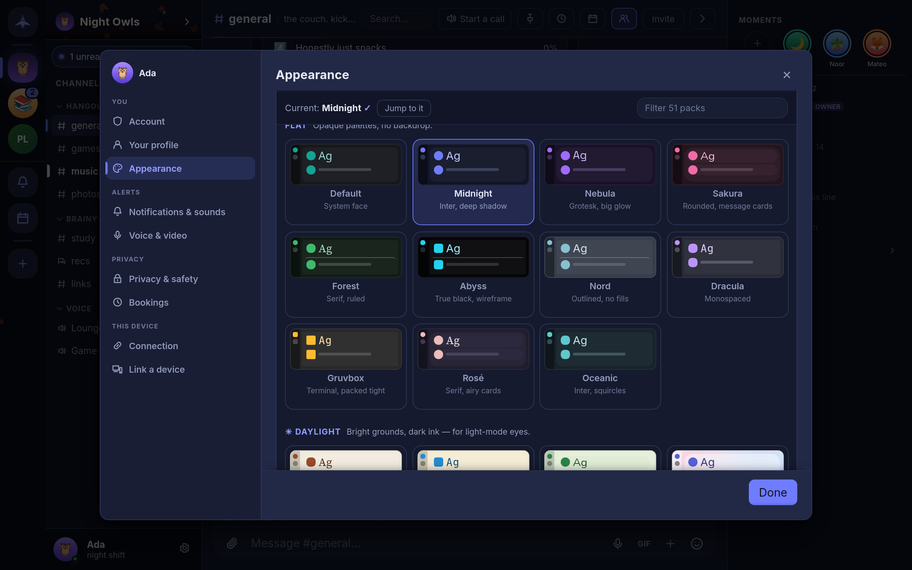

# Settings and themes

What is in Settings and where to find it, with a closer look at Appearance: themes, theme packs, effects, color, shape, font and density.

## Opening Settings

On the desktop, press `Ctrl+,` (`Cmd+,` on macOS), choose **Open settings** in the command palette (`Ctrl+K`), or select the gear next to your name at the bottom of the channel list. Settings opens on **Account** with every other page in a rail down the side. On a phone, Settings is a list of the same pages grouped under headings; tap one to open it.

Settings in Concord are kept per device. Your theme, sounds and microphone on your laptop do not change the ones on your phone. In the single-file build they are stored by the browser, so a different browser starts from the defaults. Guild-wide settings are not here; they are under **Guild settings** in each guild's menu (see [Guilds and channels](guilds.md)).

## The pages

| Group | Page | What is there |
|---|---|---|
| You | **Account** | Who you are on this device, your safety net (**Backup & restore** and **Recovery phrase**), the installed version and updates, and **Sign out (lock this device)** |
| You | **Your profile** | Name, picture, banner, availability, status, bio, birthday, profile colors and your fingerprint |
| You | **Appearance** | Theme, theme pack, effects, color, shape, font, density, scale and clock |
| Alerts | **Notifications & sounds** | Do Not Disturb, sound volume and effects, call ringtone, alert words, system notifications, and on a phone **Stay connected** |
| Alerts | **Voice & video** | Microphone, speaker and camera, voice activity or push-to-talk, noise reduction, noise gate, microphone boost, call volume and a record-and-play-back test |
| Privacy | **Privacy & safety** | What leaves this device, typing indicators, deleted messages, message requests and blocked users, app lock, and erasing the device |
| Privacy | **Bookings** | Office hours and your public booking page |
| This device | **Connection** | Rendezvous server, fixed port, public DHT fallback, and the diagnostics panel |
| This device | **Link a device** | The QR code for adding another device |

The details live on the pages for each topic:

- Account, profile and passphrase: [Accounts and identity](identity.md)
- Backups and the recovery phrase: [Backups and recovery](backups.md)
- Notifications, Stay connected and push: [Notifications](notifications.md)
- Voice & video: [Voice, video and screen sharing](voice-and-video.md)
- Privacy & safety: [Privacy and encryption](privacy.md) and [Moderation and safety](moderation.md)
- Connection: [Getting started](getting-started.md#can-people-reach-you) and [Troubleshooting](troubleshooting.md)
- Link a device: [Multiple devices](devices.md)

### Privacy & safety at a glance

The **What leaves this device** group lists every feature that makes a request outside your conversations, each with its own switch: **Link previews**, **Game title search**, **Game box art**, **GIF search**, **Hide my IP on calls** and **Rich presence**. **Typing indicators** works both ways: turn it off and you stop sending them and stop seeing other people's. Under **Deleted messages**, **Show deleted messages** leaves a faint marker where a message was removed, and **Empty trash** erases the text kept for deleted messages. **People** holds **Message requests** and **Blocked users**; blocking hides someone on this device only.

## Appearance

**Settings → Appearance** (also **Open appearance** in the command palette) is a list of sections, each showing its current value. Open one to change it. Changes apply as you make them.

### Theme

**Dark**, **Light** or **System**. System follows your operating system's light or dark setting as it changes.

### Theme pack

A theme pack restyles the whole app: its colors, and often its font, corner shape, avatar shape and message layout as well. The gallery has a filter box and a **Jump to it** button that scrolls to the pack you are using. Packs come in five sets:

| Set | What it is | Packs |
|---|---|---|
| Flat | Opaque dark palettes, no backdrop | Default, Midnight, Nebula, Sakura, Forest, Abyss, Nord, Dracula, Gruvbox, Rosé, Oceanic |
| Daylight | Light grounds with dark text | Paper, Solarized, Meadow, Porcelain |
| Animated | A moving backdrop behind translucent panels | Aurora, Synthwave, Cosmos, Molten, Prism, Monsoon, Fathom, Skyline, Eclipse, Daybreak, Dunes, Canopy, Datastream, Sonar, Lantern, Glacier, Vinyl, Storm, Blossom, Meridian, Bloom, Orbit, Radiant, Silicon, Uptime, Zellige, Atrium |
| Textured | A still color mesh behind translucent panels | Frost, Dusk, Grape |
| Effect-paired | Flat palettes designed as the ground for one effect | Tundra (Snow), Harbor (Rain), Observatory (Starfield), Hearth (Embers), Phosphor (CRT), Harvest (Leaves) |

Choosing an effect-paired pack does not turn its effect on; pick the effect separately. With an animated pack, **Sweeping highlights** turns the band of light that crosses the window on or off.

### Effects

An overlay drawn over the app: **None**, **Snow**, **Rain**, **Starfield**, **Embers**, **CRT** or **Leaves**.

### Color

The accent color used for buttons, highlights and links. Pick one of the preset swatches, or the hollow swatch, which follows the primary color of your profile theme (see [Your profile](identity.md#your-profile)). A preset overrides it on this device only.

### Shape, font and density

| Section | Options |
|---|---|
| **Shape** | How rounded panels, buttons and fields are: **Theme** (whatever the pack uses), **Sharp**, **Soft** or **Round** |
| **Font** | **Theme**, **System**, **Inter**, **Grotesk**, **Serif**, **Rounded**, **Mono**, **Legible**, **Cyber** or **Comic**. Every font is built into the app; none is downloaded. |
| **Density & scale** | **Compact**, **Cosy** (the default) or **Comfortable** message spacing, and a UI scale slider from 80% to 150%. `Ctrl+=`, `Ctrl+-` and `Ctrl+0` change the scale from anywhere. |

### Flair and clock

**Flair** has two switches: **Use guild colours**, which tints the app with the hue of each guild's banner while you are in it, and **Seasonal touches**, which adds snow in December, petals in spring and leaves in autumn. **Clock** sets how message times are shown: **Automatic** (following your locale), **12-hour** or **24-hour**.

## Language

The interface is in English. There is no language setting. Dates and times follow your system's locale.
