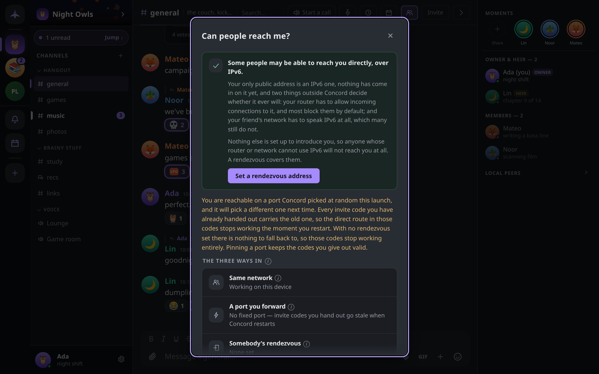

# Troubleshooting

What to do when peers cannot reach each other, messages do not arrive, a call has no sound, or the app will not open or unlock, and where to look for diagnostics.

## Start here: Can people reach me?

Most problems between two people are reachability problems. Concord has a check for it:

- press `Ctrl+K` (`Cmd+K` on macOS) and choose **Can people reach me?**, or
- open an invite and click **Can people reach me?** beside the code.

The dialog states which situation this device is in and offers the one next step for it:

| What it says | What it means | What to do |
|---|---|---|
| **People are reaching you directly.** | Someone on the internet has connected straight to this machine this session. | Nothing. |
| **Your address says people can reach you directly.** | This machine has a public address, but nobody has come in on it yet. A firewall on the machine can still refuse the port. | Nothing, unless friends fail to connect; then check the firewall. |
| **Friends on other networks reach you through your rendezvous.** | Your router refuses incoming connections; a rendezvous introduces you and carries the traffic. | Nothing. |
| **Your rendezvous is set but not answering…** | The rendezvous address is saved but nothing responds at it. | Click **Try reconnecting**. If it stays down, check the address with whoever runs the node. |
| **Only people on this same Wi-Fi can reach you.** | No rendezvous is set and the router refuses incoming connections. | Click **Set a rendezvous address**, or forward a port. |
| **Nobody can reach you right now.** | No rendezvous, and local discovery is unavailable on this device (always the case on Android). | Click **Set a rendezvous address**. |

Below the verdict, **The three ways in** shows the state of each route: **Same network**, **A port you forward** and **Somebody's rendezvous**.



### Peers cannot see each other

Two peers can talk only if at least one of them can accept an incoming connection. Work through these in order:

1. **Same Wi-Fi.** Desktops on one home network find each other with no setup. This never works on Android, and many work and campus networks drop the packets, so do not rely on it there.
2. **A rendezvous.** If anyone in the group runs one, paste its address into **Settings → Connection → Rendezvous server** and click **Save**; it applies to new connections at once. Joining with an invite code from someone who uses a rendezvous sets it for you. Running your own is covered in [Running a rendezvous](../RENDEZVOUS.md).
3. **A forwarded port.** In **Settings → Connection → Direct connection → Fixed port**, enter a number from 1024 to 65535 and click **Save**. Forward that port, TCP **and** UDP, from your router to this computer, then restart Concord. Your public IP address is then inside every invite code you hand out.

If the check says you are reachable but has no fixed port, invite codes you already gave out go stale when Concord restarts, because the port changes each launch. Click **Pin a port** to fix that.

If **Settings → Connection** warns that **the fixed port wasn't free when Concord started**, another program, often a second copy of Concord, holds the port. Close it or pick another port, and restart.

### An invite code does not work

**That code didn't open the door** with **Couldn't reach them — they're probably offline, or on a network this device can't get to from here** means nobody at the addresses in the code answered. Someone who can admit you must be online when you join. Ask them to open Concord and try again, or ask for a fresh code. If it keeps failing, run the reachability check on both sides.

## Messages are not arriving

**A message of yours shows Sending… or Not sent.** It has not gone out. Click **Retry** once you are connected again, or **Discard** to drop it. **Slow mode — you can send this in Ns** means the channel limits how often you post.

**A guild shows Catching up with N peers…** This device missed an update to the guild's encryption and is fetching it from members who are online. It clears on its own.

**A guild shows Waiting for someone with the missing updates to come online.** Nobody online right now has what this device is missing. It clears when one of them connects. If you are the only member left, the banner says so and offers **Continue from here**.

**Messages sent while you were offline never show up.** With a rendezvous set, each message is also left, encrypted, in the rendezvous mailbox of every member device that was offline when it was sent, and collected when that device reconnects. The mailbox is a safety net, not storage:

- it holds messages for 14 days and up to 200 per device;
- it keeps them in memory, so a rendezvous restart empties it;
- without a rendezvous there is no mailbox, and missed messages arrive only when a member who has them is online at the same time as you.

Anything the mailbox dropped still arrives from any member who holds it once you are both online. To force a catch-up, open **Can people reach me?**; when the rendezvous is not answering, **Try reconnecting** re-dials it, collects the mailbox and syncs with connected peers.

**A direct message from someone new never appeared.** A DM from someone you share no guild with, have not verified and never messaged first goes to **Settings → Privacy & safety → Message requests**.

**One person's messages are missing.** Check **Settings → Privacy & safety → Blocked users**. The block list is kept on each device separately, so a phone and a desktop can disagree.

**Notifications stop on Android after the app is closed.** See [Android stops receiving in the background](#android-stops-receiving-in-the-background).

## Calls with no audio or video

**Microphone blocked — you're in listen-only mode.** The operating system or browser refused microphone access. Allow it for Concord (or for the browser tab running the web build) and join again.

**No microphone found** or **Your microphone couldn't be opened.** No input device was found, or another program is holding it. Close the other program, or pick a different device under **Settings → Voice & video**.

**You can join, but nobody hears anybody.** If **Hide my IP on calls** is on in **Settings → Privacy & safety**, calls are forced through the rendezvous's media relay. A relay that is advertised but cannot carry traffic leaves calls connected and silent. Turn the setting off to test; if calls then work, tell whoever runs the rendezvous (see [If it is not working](../RENDEZVOUS.md#if-it-is-not-working)). When the rendezvous has no media relay at all, the setting says so and calls connect directly.

### Linux desktop app

The Linux desktop window runs on WebKitGTK, which handles audio and video through GStreamer. Concord turns on the webview's camera and microphone support itself; the GStreamer plugins have to come from your system.

- **This machine can't make calls: … the WebRTC plugins are missing.** Install your distribution's `gst-plugins-good` and `gst-plugins-bad` packages (package names vary by distribution) and restart Concord. Everything except calls works without them.
- **No microphone found** while the microphone works in other programs usually means `gst-plugins-good` is missing.

The web build (`concord-linux-amd64-<version>`, which opens in your browser) uses the browser's own media stack and does not need these plugins.

**The window is blank or the app crashes at start on Wayland.** Concord picks a WebKitGTK rendering mode for Wayland on its own, and leaves it alone if you set one. To override it, start Concord with `WEBKIT_DISABLE_DMABUF_RENDERER=1` in the environment.

## The app will not install or open

### Windows SmartScreen or Defender blocks it

Concord's Windows binaries are not code-signed, so SmartScreen warns about each new release.

- On **Windows protected your PC**, click **More info**, then **Run anyway**.
- If Defender quarantines the file, open **Windows Security → Virus & threat protection → Protection history**, find the Concord item, and choose **Allow** (and **Restore** if it was removed).

[WINDOWS.md](../../WINDOWS.md) has the full steps, including a folder exclusion for repeated blocks. Every release asset is listed in `SHA256SUMS` with an Ed25519 signature, and the app checks that signature before installing an update.

### The web build exits at start

The web build serves its interface on `127.0.0.1:8787`. If another program, or a second copy of Concord, holds that address, it retries for about five seconds and then exits with an error. Close the other copy, or start this one on a different address with `CONCORD_WEB_ADDR=127.0.0.1:8788`.

### Android stops receiving in the background

On Android, Concord receives only while its process runs. **Settings → Notifications & sounds → Background → Stay connected** (on by default) runs a foreground service with a persistent notification so the node stays connected while the app is closed.

- If messages only arrive when the app is open, check that **Stay connected** is on and that Concord is allowed to post notifications.
- Android 15 limits this kind of service to six hours in any 24. When the limit is reached, the notification disappears and the node keeps running only as long as Android allows. Opening Concord starts it again.
- Messages missed while the process was stopped wait in the rendezvous mailbox and arrive when Concord next runs.

## Forgotten passphrase

The passphrase is never stored anywhere and cannot be looked up or reset. On the unlock screen, click **Forgot passphrase?** and choose:

- **Re-link from my other device** — if this account is signed in on another device, link from it. Profile, guilds and history all come back. See [Multiple devices and sync](devices.md).
- **Use my recovery phrase** — enter the 24 words and a new passphrase. This restores your account key: you are the same person to anyone who has verified you. It does **not** restore data. The device starts with no guilds and no history; ask someone in each guild for a fresh invite, then restore a backup if you have one. See [Backups and recovery](backups.md).
- **I have neither — start over (deletes everything)** — wipes the identity on this device. Nothing can bring it back.

## Diagnostics and logs

**Insights & diagnostics** shows this device's state: database and attachment sizes, peers and connections, the rendezvous, bandwidth, whether the device is **Reachable from outside**, and for each guild whether it is **in sync** or **healing…**. Open it from **Settings → Connection → Stats & diagnostics**, with `Ctrl+Shift+,` (`Cmd+Shift+,` on macOS), or for one guild from its menu under **Stats & diagnostics**.

Concord writes no log file. Its log lines go to standard error, so to see them, start it from a terminal, for example on Linux:

```sh
./concord-desktop-linux-<version>
```

The headless `concord` binary and the rendezvous node log to standard error too.

## Where your data is

Everything Concord keeps on a device is in one directory, created readable by your user only:

| Platform | Default location |
|---|---|
| Linux | `~/.config/concord` |
| macOS | `~/Library/Application Support/concord` |
| Windows | `%AppData%\concord` |
| Android | The app's private storage |

It holds the encrypted identity (`keystore.json`) and the database (`concord.db`), among other files. Deleting it deletes this device's identity and history.

### CONCORD_HOME

Set `CONCORD_HOME` to use a different directory. Concord creates it if it does not exist.

```sh
CONCORD_HOME=~/concord-test ./concord-desktop-linux-<version>
```

Use it to keep data on another disk, or to run a second, separate identity on the same machine. Each directory is one device: never run two copies of Concord on the same one. Two copies at once also need different `CONCORD_WEB_ADDR` values for the web build.

Two more environment variables help when diagnosing connections, in the app and in the headless `concord` binary:

| Variable | Effect |
|---|---|
| `CONCORD_BOOTSTRAP` | Comma-separated rendezvous addresses to use in addition to the saved one. |
| `CONCORD_DISABLE_MDNS=1` | Turns off same-network discovery, so you can test the path a friend elsewhere would use. |
