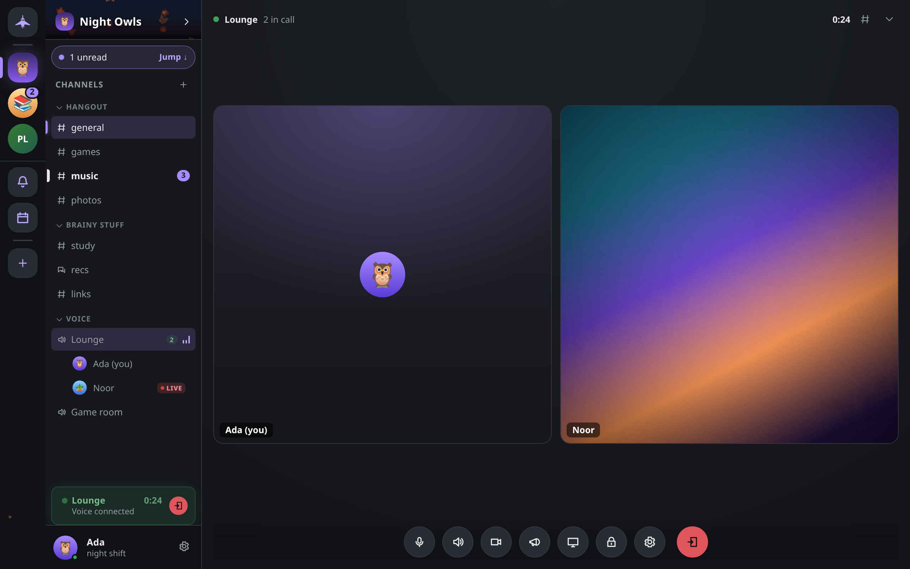

# Voice, video and screen sharing

How to talk, turn on a camera and share your screen in voice channels, direct-message calls and meetings, how to set up your microphone and push-to-talk, and how calls connect: directly between participants, or through a relay that hides your IP address.

## How calls work

Every call is a mesh: each participant's app opens a direct, encrypted WebRTC connection to every other participant. Audio and video are encrypted end to end with DTLS-SRTP and never pass through any Concord server, because there is none. The app only uses your peers and your rendezvous to arrange the connection.

A mesh means you send one copy of your audio and video to each person in the call. Concord sets no limit on how many people can join, but the upload your connection needs grows with every participant, so calls work best in small rooms. There is no media server that could mix or forward streams for a large room.

## Joining and leaving

- **Voice channel:** click it in the channel list to join. You stay where you were in the chat; click the channel again (or your own name under it) to open the full call view. To read a voice channel's chat without joining, right-click it and choose **Open chat**.
- **Direct message or meeting:** use **Start a call** in the chat header. On a phone it is **Call** in a direct message and **Voice** elsewhere.
- **Leave:** choose **Leave call** in the call controls.

To create a voice channel, pick the **Voice** type when you create a channel. See [Guilds and channels](guilds.md).

If Concord cannot open a microphone, you join listening only, and the call controls offer **Try again**.

### Incoming calls

When someone is in a call in one of your direct messages and you are not, Concord rings with the **Call ringtone** you picked in **Settings → Notifications & sounds** and shows **is calling you…** with **Decline** and **Join**. Declining stops the ring until that call ends. A call you start that nobody answers leaves a **Missed call** line in the conversation.

Someone in a call can also invite you; you see **wants you in** with **Not now** and **Join**.

### Locked calls

Anyone in a call can choose **Lock call** in a direct message or meeting; in a guild it needs the guild owner or **Manage Channels**. A locked call shows **Call locked — knock to join** in the channel list. Trying to join sends a knock instead, and you wait with a **Knocking…** pill (choose **Cancel** to give up). People inside see an **At the door** list with **Admit** and **Ignore** (or **Refuse** for a guest). Once admitted, you can leave and come back without knocking again. **Unlock call** lets anyone in.

## Call controls

| Control | What it does |
|---|---|
| **Mute** / **Unmute** | Your microphone. `Ctrl+Shift+M`. |
| **Deafen** / **Undeafen** | Silences everyone for you, and mutes your microphone too. `Ctrl+Shift+D`. |
| **Turn on camera** / **Turn off camera** | Your camera. **Switch camera** appears when you have more than one. |
| **Share screen** / **Stop sharing** | Shares a screen, window or tab. Not offered where the platform cannot capture the screen. |
| **Soundboard** | Plays short sounds into the call (desktop). |
| **Audio output** | On a phone, switches between earpiece, speaker and Bluetooth. |
| **Lock call** / **Unlock call** | See [Locked calls](#locked-calls). |
| Gear | Opens **Voice & video** settings. |
| **Leave call** | Leaves. |

The keyboard shortcuts work only while you are in a call, and they work even while you are typing. On macOS, use `Cmd` in place of `Ctrl`.

On a phone, the less common controls are under **More call controls**. Each person's tile has a menu with **Mute** *name* **for me**, which silences them on your device only, and a volume slider that also affects only you.

While you move around the app, a small floating window keeps the call's main controls in reach; **Return to the call** opens the full view again.

## Video and screen sharing

Your camera and your screen share each go to everyone in the call. Screen sharing captures at up to 30 frames per second.

- **Sound with a screen share:** if your system offers the shared window's or screen's audio, it goes with the share, and Concord says **Sharing your screen, with sound**. If it does not, the share is silent. You can then pick an input device to send in its place, under **Settings → Voice & video → Advanced audio → Screen-share sound**. It is only used when the share itself arrives silent.
- **Who is watching:** when someone's app starts showing your share, you get a notice: *name* **is watching your screen**.

## Settings → Voice & video

| Setting | Default | What it does |
|---|---|---|
| **Microphone** | System default | Which microphone to use. **Hear myself** records a moment and plays it back. |
| **Speaker** | System default | Which output to use, with **Test** and a call **Volume** (100%). Only where the platform lets apps choose the output. |
| **Camera** | System default | Which camera, with a **Test** preview. |
| **Mic activation** | Voice activity | **Voice activity** or **Push to talk**. Desktop only. |
| **Boost** | 1× | Input gain, under **Advanced audio**. |
| **Noise reduction** | Off | Off, Low, Medium or High. |
| **Noise gate** | Off | Keeps the microphone shut below a level you set with **Opens at**. |
| **Echo cancellation**, **Noise suppression**, **Automatic gain** | On | The platform's own voice processing. |
| **Screen-share sound** | Whatever the system shares | See above. |
| **Quality** | High — 64 kbit/s | Your outgoing audio bitrate, from Low (24 kbit/s) to Studio (128 kbit/s). You send one copy per person in the call, so higher settings cost more upload in bigger rooms. |

If device names show as blank, choose **Show device names**; the platform hides them until you allow microphone access.

On a phone, the system decides where call audio goes; use its speaker or Bluetooth controls, or **Audio output** in the call.

### Push-to-talk

1. Open **Settings → Voice & video** and set **Mic activation** to **Push to talk**.
2. Choose **Set a key** and press the key you want to hold.

No key is set until you choose one. Your microphone stays shut until you hold the key, and closes a moment after you let go. The key only works while Concord's window has focus. If you pick a key that types a character, Concord warns you. Push-to-talk is not offered on phones.

## Hiding your IP address

A direct connection means everyone in the call learns your IP address, as they do in any peer-to-peer call. A **TURN relay** on your rendezvous avoids that. Your media then goes through the relay, still encrypted end to end, so the other participants see the relay's address instead of yours.

When a call starts, Concord asks your rendezvous for its call configuration.

- If the rendezvous runs a TURN relay, it hands out short-lived credentials (valid for an hour), and your call can be relayed.
- **Meetings** always relay when a relay exists. For any other call, turn on **Settings → Privacy & safety → Hide my IP on calls**.
- If the rendezvous has no relay, calls connect directly. With **Hide my IP on calls** on, Concord tells you once: **Can't hide your IP — this rendezvous isn't running a media relay. The call still connects.** The setting stays on and starts working if a relay appears.
- If your rendezvous provides no call configuration at all, Concord falls back to a public STUN server (`stun.l.google.com`) to learn your external address. The shipped rendezvous lists the same server alongside its relay.

The relay runs over TCP. Its operator can see that you are in a call and with which addresses, but not the media. Setting one up is covered in [Running a rendezvous](../RENDEZVOUS.md#options). What each party can see is summed up in [Privacy and encryption](privacy.md).

## Meetings with browser guests

A meeting is a short-lived guild with one channel that is also its call room. People with only a link can join from a web browser, with nothing to install.

1. In the guild rail, choose **+** (**Add a guild**), then **Instant meeting**.
2. If you have no rendezvous set, Concord asks first. Choose **Start without guest links** to run the meeting for app users only, or **Point it at a rendezvous first**.
3. The **Your meeting is live** dialog shows the **Guest link — no install**. Choose how long it **Works for**: 1 hour, 24 hours, 7 days or 30 days. Then **Copy link**, or **Copy link + a friendly note**. **Invite to the full app** gives an invite code for people who have Concord.

Guest links work only when your rendezvous has a DNS name and its operator has enabled the guest gateway. Otherwise Concord tells you that guest links need a rendezvous.

What a guest gets:

- The meeting's chat. Their messages are labelled **(guest)**.
- A call with the meeting's host: microphone, camera and screen sharing, with media going directly between the guest's browser and the host's app (through the relay when there is one). Other members in the call do not connect to the guest.
- Nothing else in Concord: no other guild, no direct messages, no history beyond the meeting.

Up to five guests can be in a meeting at once. Guest names are limited to 24 bytes and messages to 2,000 bytes, and chat is rate-limited. A guest who is idle for 30 minutes (3 hours while in the call) is disconnected. Everything ends when the link or the meeting expires. To make guests wait for approval, lock the call; they knock, and the host sees them **knocking with an invite link**. To remove one, choose **Remove from call** in their tile's menu.

A guest has no keys, so their connection ends at the rendezvous and the host's app instead of being encrypted end to end. The rendezvous could read a guest's own chat messages. See [Privacy and encryption](privacy.md#what-a-rendezvous-node-sees).

## Calls on Android

During a call, Concord runs a foreground service so the microphone keeps working when you switch apps. The tray shows **In a call** with a **Hang up** action; tap it to return to the call. On the earpiece, the proximity sensor turns the screen off while the phone is at your ear.
